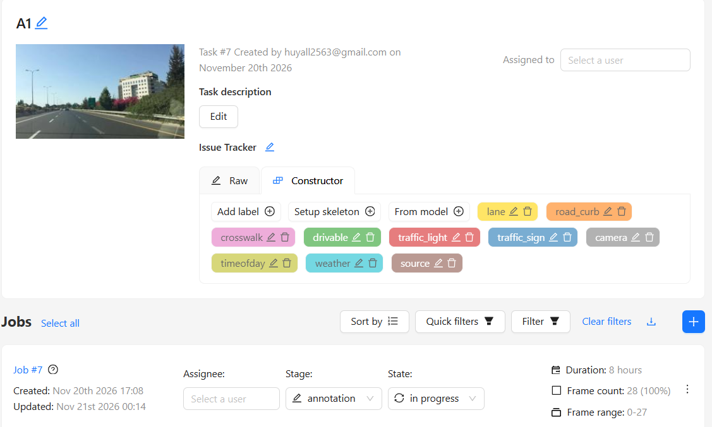
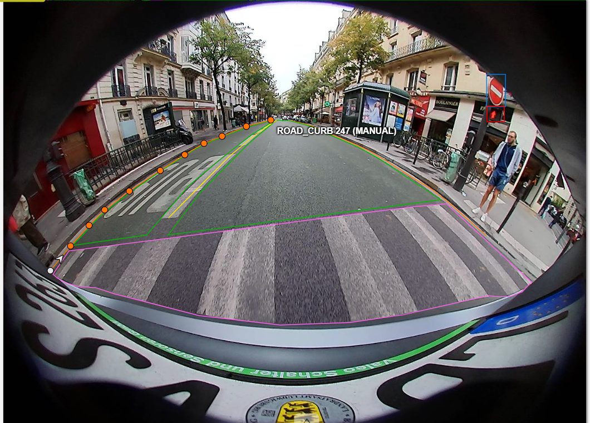
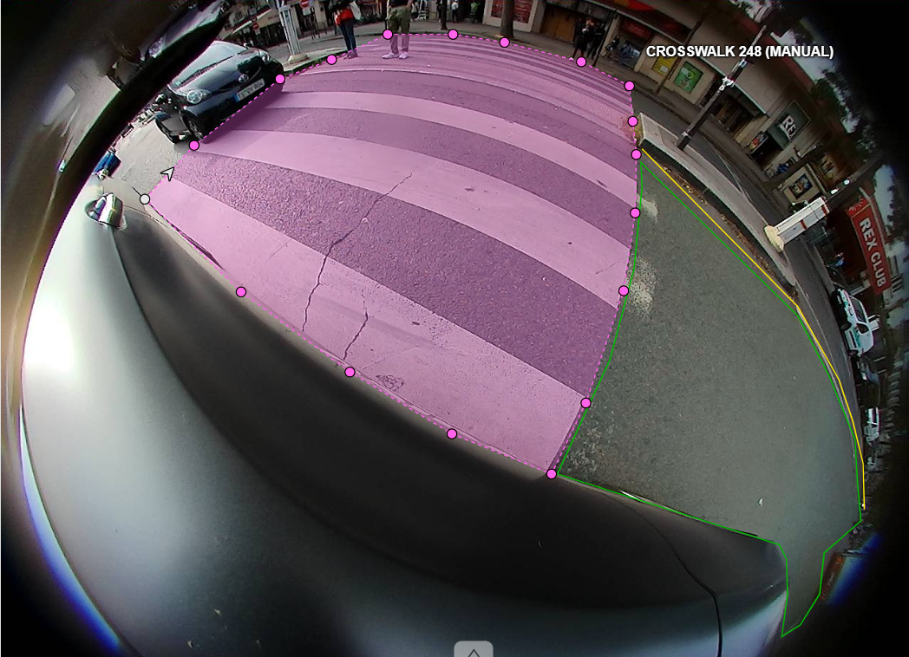
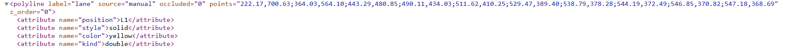

# Báo cáo cá nhân — Ngày 11
Họ tên: Đặng Minh Huy        Mã học viên: 2A202603162 
  
Guideline: Road v1.0    Lần nộp (`revision` trong manifest): 1  
Thời điểm export : 2026-11-20 17:14 UTC    Số lần nộp lại sau Rework: 0  

## 1. Kiểm project
| Mục | Đúng như guideline Road v1.0? | Ghi chú |
| --- | --- | --- |
| 6 label, đúng kiểu | Có (cần đối chiếu tab Labels) | lane polyline, road_curb polyline, crosswalk polygon, drivable polygon, traffic_light box, traffic_sign box |
| Thuộc tính và giá trị | Có | position/style/color/kind; area_type; color/type/facing/edge_zone; group/facing/edge_zone |
| 4 tag ảnh | Có | camera, timeofday, weather, source — mỗi tag một thuộc tính `value` |
Cách kết thúc polyline trên bản CVAT này: nhấn **Enter** (hoặc click đúp) để đóng polyline; mỗi lần Enter là một shape mới, nên vạch đứt phải vẽ liền một lần rồi đóng, không Enter giữa chừng. *(Xác nhận lại trên bản CVAT của bạn ở Help → About.)*  
Cách đặt tag ảnh trên bản CVAT này: Tag → chọn label → chọn giá trị `value`  
**Tự sửa trước khi nộp (`road_check lint` phát hiện, không phải mắt thường):** bổ sung `camera=front` cho A01–A16; `source=real` cho 28 ảnh; sửa 6 tag camera fisheye sai (B01, B02, B04, B07, B08, B11, B12); `position=other` cho lane ở B05–B08 (camera hai bên); `edge_zone=bật` cho B03/B04 (tâm box ngoài 80 % bán kính); xoá 3 điểm lặp ở drivable A04/A07/A16; sửa A02 polyline (411,720) R1→L1. Chi tiết nguyên nhân ở mục 7a.

## 2. Số lượng đã gán
| Task | Ảnh | lane | road_curb | crosswalk | drivable | traffic_light | traffic_sign |
| --- | ---: | ---: | ---: | ---: | ---: | ---: | ---: |
| front | 12 | 26 | 7 | 8 | 36 | 24 | 12 |
| front-extra (đã làm 4 / 4) | 4 | 8 | 1 | 4 | 8 | 6 | 11 |
| fisheye | 8 | 9 | 5 | 10 | 14 | 5 | 4 |
| fisheye-extra (đã làm 4 / 4) | 4 | 0 | 2 | 5 | 3 | 0 | 0 |

## 3. Bảng ca khó
| Ảnh | Nhãn | Phân vân giữa | Đã chọn | Lý do |
| --- | --- | --- | --- | --- |
| A05 | lane | Vẽ L1/R1 hay để trống | Để trống | Ảnh đường vắng, vạch hai bên xe mờ và bị bóng đổ che gần hết đáy ảnh; guideline cho phép bỏ khi thật sự không thấy vạch. Đã ghi mã ảnh vào phiếu xin coach xác nhận. |
| A06 | lane | Một polyline có `occluded` hay hai polyline riêng | Một polyline, bật `occluded` | Vạch L1 bị xe tải phía trước che giữa chừng; guideline yêu cầu một polyline xuyên chỗ che, không tách hai. |
| A06 / A08 | drivable | Mép dưới: hết ở capo xe hay hết ở đáy ảnh | Dừng tại mép capo | Rule "không gán phần thân xe". Vùng đầu tiên tôi kéo chạm đáy ảnh và bị trừ lỗi tràn. |
| A09 | lane | Vạch ngoài cùng trái: `L1`, `L2` hay `other` | `L1` cho vạch sát xe, dòng cũ @(448,661) đang là `other` — chờ xác nhận | Sau khi sửa A02, cách xác định là đếm từ vạch sát mũi xe ra ngoài; vạch mép trái ảnh không đủ sáng nên tôi tạm để `other`, cần coach chốt. |
| A12 | lane | Hai polyline cùng `L1`: vạch đứt hay hai vạch khác nhau | Tách riêng, đang chờ gán lại `position` | lint báo QC1-05 (2 polyline cùng `L1`). Một vạch bị xe con che nên tôi vẽ hai đoạn; phải đổi sang `occluded` hay gán polyline thứ hai là `R1` còn tuỳ nhìn ảnh. |
| A08 | traffic_light | 9 đèn: cái nào là đèn thật, cái nào đèn hậu ô tô | Gán toàn bộ, xoá hình in | Mật độ đèn dày, đèn hậu xe phía trước dễ nhầm với đèn tín hiệu đỏ. Đây là chỗ tôi sai nhiều nhất (QC1-08). |
| A15 | traffic_sign | 10 biển: gộp cụm hay mỗi biển một box | Mỗi biển một box, biển phụ riêng | Nhóm biển phụ đặt dưới biển chính phải tách box riêng; dễ nhầm vì sát nhau theo chiều dọc. |
| A03 / A14 | traffic_sign, traffic_light | `facing` side hay front khi biển xoay chếch | `front` nếu đọc được nội dung, `side` nếu chỉ thấy cạnh | Quy tắc thực dụng: thấy mặt biển thì `front`, chỉ thấy sườn thì `side`. |
| B01 / B09 | lane (fisheye) | Vẽ cung cong hay kẻ thẳng 2 điểm | Vẽ cung, thêm điểm | Fisheye làm vạch cong mạnh; polyline 2 điểm bị lint báo QC1-11. Tôi chưa kịp thêm điểm cho đủ ≥4 điểm/đoạn cong. |
| B05–B08 | lane (fisheye hai bên) | `position` theo làn hay `other` | `other` (đã sửa) | Camera MVL/MVR không xác định làn nào là của xe, guideline bắt buộc `other`. |
| B03 / B04 | traffic_sign | Bật hay tắt `edge_zone` | Bật | Tâm box nằm ngoài 80 % bán kính ảnh fisheye. |

## 4. Phiếu QC 1 nhận được
Bạn kiểm lô của tôi: **[điền]**    Quyết định nhận được: **[điền]**  
| Mã lỗi | Số lỗi | Đồng ý? | Đã sửa? |
| --- | ---: | --- | --- |
| (chưa nhận phiếu) | | | |

## 5. Kiểm file export
| File | Mở lại được? | Số shape ảnh 1 (job / file) | Số shape ảnh 2 (job / file) | Tag camera có trong XML? |
| --- | --- | --- | --- | --- |
| DangMinhHuy-front.zip | Có (`lint` PASS) | A01: 8 / A01: 8 | A02: 7 / A02: 7 | Có, đủ 16/16 |
| DangMinhHuy-fisheye.zip | Có (`lint` PASS) | B01: 6 / B01: 6 | B02: 6 / B02: 6 | Có, đủ 12/12 |

## 6. Ảnh chụp màn hình
1. Tab Labels của project (6 label hình + 4 label tag):

   

2. Một ảnh camera trước đã gán đủ (làn, vùng lái, đèn/biển): **[còn thiếu — chụp bổ sung một ảnh A trên CVAT]**
3. Một ảnh fisheye đã gán, phóng to đoạn polyline cong:

   

   

4. Một đoạn XML có `<polyline label="lane">` kèm bốn thuộc tính:

   

## 7. Tự đánh giá

### 7a. Vấn đề gặp phải trong buổi lab

**1. Quên gán tag ngay từ đầu — lỗi tốn điểm nhất (QC1-01, 22 lỗi).**
Toàn bộ 16 ảnh front không có tag `camera`, và cả 28 ảnh thiếu tag `source`, vì tôi để dành việc gán tag xuống cuối buổi làm một lượt. Hệ quả:
* Ở task fisheye, khi gán nhanh tôi áp cùng một giá trị `fisheye_front` cho nhiều ảnh khác camera → 6 ảnh sai (B01, B02, B04, B07, B08, B11, B12) so với hậu tố tên file WoodScape (FV/RV/MVL/MVR).
* Lỗi này là **lỗi nặng** theo phiếu QC và theo tiêu chí "Đạt", tức chỉ riêng nó cũng đủ khiến lô bị Rework dù phần vẽ đúng hết.
* Cách tránh ở Ngày 20: gán bốn tag cho ảnh đầu tiên của job **trước khi vẽ bất kỳ shape nào**, tận dụng CVAT nhân thuộc tính cho ảnh cùng job; riêng Set B thì chia job theo camera để không thể nhầm hậu tố.

**2. Hiểu sai quy tắc "vẽ từ gần ra xa" và điểm bắt đầu polyline.**
Khi mới vẽ tôi quen kéo từ phía chân trời về phía xe cho tiện nhìn. Sau khi lint báo, tôi nhận ra checker lấy **điểm đầu** làm điểm gần xe để làm row-anchor, nên chiều vẽ sai sẽ làm hỏng toàn bộ ý nghĩa huấn luyện (đích ở hàng y=720 không tồn tại). Ở các ảnh làn dài, tôi còn click hai lần liên tiếp làm sinh điểm trùng nhau (drivable A04, A07, A16) — đây là lỗi thao tác chuột, không phải lỗi hiểu biết, nhưng vẫn bị tính QC1-12.

**3. Xác định `position` của làn khi xe không ở giữa làn (A02, A09, A12).**
Không có quy tắc nhìn nhanh, tôi đoán theo "trái/phải của khung hình" thay vì "trái/phải của xe". Hệ quả: A02 bị gán `R1` cho vạch xuất phát từ x=411 ở đáy ảnh (thực tế là vạch bên trái mũi xe), vừa thừa R1 vừa thiếu L1. Bài học: lấy mép capo xe làm mốc chia trái/phải, rồi đếm vạch theo thứ tự L1/L2 từ mốc đó.

**4. Vạch đứt và chỗ bị che (A06, A12) — mất thời gian nhất.**
Lúc đầu tôi tách mỗi đoạn của vạch đứt thành một polyline vì CVAT kết thúc polyline mỗi lần nhấn Enter. Sau đó phải vẽ lại theo đúng một polyline cho cả vạch, và dùng cờ `occluded` cho đoạn bị xe khác che. lint vẫn còn báo QC1-05 "2 polyline cùng `position`" ở A12, nghĩa là phần này tôi chưa xử lý xong trước lúc export.

**5. Phân biệt đèn tín hiệu với đèn phương tiện ở ảnh đông xe (A08, A14).**
A08 có tới 9 box đèn; vài đèn hậu ô tô màu đỏ rất giống đèn tín hiệu, ngược lại vài đèn tín hiệu nhỏ dưới 8 px. Tôi chọn hướng an toàn là không gán hình in và bỏ đèn dưới 8 px, nhưng không chắc đã đủ đèn theo GT — đây là dòng tôi muốn coach kiểm lại.

**6. Vùng lái được `drivable`: chia quá nhiều polygon nhỏ.**
Vùng drivable của tôi chia nhiều polygon nhỏ (44 polygon cho 16 ảnh) thay vì gộp theo `direct`/`alternative`. Cách chia nhỏ làm tăng nguy cơ tràn ra vỉa hè hoặc thân xe ở mép polygon, và dễ lệch IoU khi ghép GT. Tôi chưa kịp rà lại toàn bộ xem có polygon nào chồng lấn nhau không.

**7. Fisheye: polyline quá thưa và `edge_zone` suy luận bằng mắt.**
Với ảnh fisheye, đoạn cong mà chỉ đặt 2–3 điểm thì nhìn trên màn hình vẫn "đúng", nhưng khi zoom ra thì lệch tâm vạch rất nhiều → 5 cảnh báo QC1-11 còn mở (B01×2, B02, B03, B08). Ngoài ra quy tắc 80 % bán kính cho `edge_zone` không nhìn ra bằng mắt được; tôi chỉ sửa được hai biển B03/B04 sau khi chạy `lint`, còn lại cần kiểm từng box.

**8. Việc thủ công vượt quá sức người, và giới hạn của `lint`.**
Bốn mục tag, `position=other` cho camera hai bên, `edge_zone`, điểm trùng — tổng 28 lỗi — tôi không tự tìm ra khi gán, mà chỉ thấy sau khi chạy `road_check lint`. Ngược lại, `lint` không so với GT nên nó **không** nói cho tôi biết: vẽ làn có lệch quá 5 px không, thuộc tính `style`/`color`/`kind` có khớp không, box có sát vỏ không. Nên tự lượng giá: phần hình học của tôi có thể trông ổn nhưng vẫn chưa được chấm thật.

### 7b. Tự đánh giá lỗi theo mã QC1
Lỗi nhiều nhất hôm nay (theo mã QC1): QC1-01 (thiếu/sai tag camera — 22 lỗi) và QC1-02 (thiếu L1/R1 ở 7 ảnh). Cách tránh ở Ngày 20: gán 4 tag ngay khi mở ảnh đầu tiên của job, dùng job theo camera để không nhầm tag fisheye; sau mỗi 3 ảnh chạy self-QC đếm L1/R1.  
Nhãn đi vào model: `position` của lane là input trực tiếp của model học vạch ego-lane cho LKA. Ví dụ lỗi đã sửa ở A02 (vạch trái gán `R1`): model sẽ học rằng vạch bên trái tài xế là vạch phải, làm lệch hướng đánh lái dự đoán về phía lề trái.  

## 8. (Tùy chọn, buffer) Từ polyline đến đích row-anchor
| y | 720 | 680 | 640 | 600 | 560 |
| --- | ---: | ---: | ---: | ---: | ---: |
| x của chúng tôi | | | | | |
| x của bạn kia | | | | | |

*(chạy: `PYTHONPATH=src python -m road_lab.rowanchor DangMinhHuy-front.zip --image A01`)*

---
## PHỤ LỤC:Self-QC — 14 cảnh báo lint còn lại (phải mở ảnh trên CVAT để quyết)

**QC1-02 nặng — thiếu L1/R1 (8):** nếu ảnh thật sự thấy vạch thì vẽ/thêm `position` đúng; nếu không thấy vạch, ghi mã ảnh vào phiếu gọi coach:
1. A05 — chưa có gì (drivable đơn, có thể làn bị mờ — kiểm kỹ).
2. A06 — mới có L1@(445,417), thiếu R1 (vạch phải sát xe, rất có thể bị cắt ở mép dưới — vẽ từ đáy ảnh).
3. A07 — R1@(775,566), R2@(1279,481): thiếu L1 — vẽ vạch trái hoặc xác nhận không có.
4. A08 — R1@(761,442), R2@(1280,484): thiếu L1.
5. A09 — other@(448,661), L1@(528,664): R1 thiếu; và dòng `other` nhiều khả năng là L2 bị gán nhầm.
6. A12 — L1 hai polyline@(349,468)+(569,439) + L2: một trong hai (569,439) có thể là R1; kiểm tra có phải vạch đứt bị tách không (QC1-05).
7. A14 — mới L1@(315,611), thiếu R1.

**QC1-11 chính — fisheye polyline quá thưa (6):** thêm điểm dọc theo độ cong (≥4 điểm):
8. B01 road_curb@(566,374) — 2 điểm. 9. B01 road_curb@(1205,626) — 2 điểm.
10. B02 lane@(538,383) — 2 điểm. 11. B03 lane@(342,534) — 3 điểm. 12. B08 lane@(381,541) — 3 điểm.

**Gợi ý thêm:** B09–B12 (extra, đang không có lane nào): kiểm ảnh — camera FV/RV thường thấy vạch cong, vẽ thêm để lấy +0,5/ảnh.
